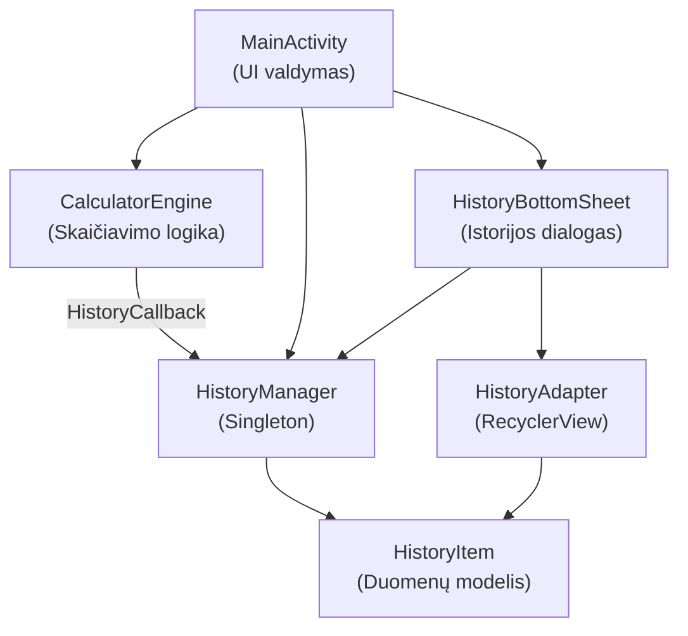

# 🧮 Skaičiuotuvas (Calculator)

**Android skaičiuotuvo programa**, sukurta pagal „Windows Calculator" (Standard režimas) dizainą. Programa palaiko pagrindines aritmetines operacijas, mokslines funkcijas, atminties valdymą ir skaičiavimų istoriją.

> **Paketo pavadinimas:** `com.example.calculator_ver20261116`
> **Versija:** 1.0 · **Min SDK:** 24 (Android 7.0) · **Target SDK:** 37

---

## 📋 Turinys

- [Funkcionalumas](#-funkcionalumas)
- [Ekrano vaizdas](#-ekrano-vaizdas)
- [Sistemos reikalavimai](#-sistemos-reikalavimai)
- [Diegimas ir paleidimas](#-diegimas-ir-paleidimas)
- [Naudojimo instrukcija](#-naudojimo-instrukcija)
- [Projekto struktūra](#-projekto-struktūra)
- [Technologijos](#-technologijos)
- [Testavimas](#-testavimas)
- [Lokalizacija](#-lokalizacija)
- [Licencija](#-licencija)

---

## ✨ Funkcionalumas

### Pagrindinės aritmetinės operacijos

| Mygtukas | Operacija | Aprašymas |
|----------|-----------|-----------|
| **+** | Sudėtis | Sudeda du skaičius |
| **−** | Atimtis | Atima vieną skaičių iš kito |
| **×** | Daugyba | Sudaugina du skaičius |
| **÷** | Dalyba | Padalina vieną skaičių iš kito |
| **=** | Rezultatas | Apskaičiuoja ir parodo rezultatą |

### Mokslinės / papildomos funkcijos

| Mygtukas | Funkcija | Aprašymas |
|----------|----------|-----------|
| **x²** | Kėlimas kvadratu | Pakelia rodomą skaičių kvadratu |
| **²√x** | Kvadratinė šaknis | Apskaičiuoja kvadratinę šaknį |
| **¹/x** | Atvirkštinis skaičius | Apskaičiuoja 1 ÷ x |
| **%** | Procentai | Apskaičiuoja procentinę dalį |
| **⁺/₋** | Ženklo keitimas | Pakeičia skaičiaus ženklą (teigiamas ↔ neigiamas) |

### Įvesties valdymas

| Mygtukas | Funkcija | Aprašymas |
|----------|----------|-----------|
| **C** | Valyti viską | Išvalo visą skaičiavimą ir grąžina pradinę būseną |
| **CE** | Valyti įvestį | Išvalo tik dabartinę įvestį (esamą skaičių) |
| **⌫** | Trinti simbolį | Ištrina paskutinį įvestą skaitmenį |
| **.** | Dešimtainis taškas | Pradeda dešimtainę dalį |

### Atminties funkcijos

Skaičiuotuvas turi pilną atminties valdymo sistemą:

| Mygtukas | Funkcija | Aprašymas |
|----------|----------|-----------|
| **MS** | Memory Store | Išsaugo rodomą reikšmę į atmintį |
| **MR** | Memory Recall | Atšaukia (įkelia) reikšmę iš atminties |
| **MC** | Memory Clear | Išvalo atmintį |
| **M+** | Memory Add | Prideda rodomą reikšmę prie atmintyje esančios |
| **M−** | Memory Subtract | Atima rodomą reikšmę nuo atmintyje esančios |
| **M∨** | Memory List | Parodo / įkelia atmintyje saugomą reikšmę |

> [!NOTE]
> Mygtukai **MC**, **MR** ir **M∨** yra neaktyvūs (pilki), kol atmintyje nėra išsaugotų reikšmių. Jie tampa aktyvūs, kai tik reikšmė išsaugoma mygtuku **MS** arba **M+** / **M−**.

### Skaičiavimų istorija

- Visi atlikti skaičiavimai automatiškai fiksuojami sesijos metu.
- Istoriją galima peržiūrėti paspaudus **laikrodžio piktogramą** (🕐) viršutiniame dešiniajame kampe.
- Istorija rodoma apatiniame išskleidžiamame lapo dialoge (*Bottom Sheet*).
- Galima pasirinkti bet kurį ankstesnį rezultatą ir jis bus įkeltas atgal į skaičiuotuvą.
- Galima **išvalyti visą istoriją** paspaudus šiukšliadėžės piktogramą istorijos dialoge.

> [!IMPORTANT]
> Istorija saugoma tik kol programa veikia (sesijos metu). Uždarius programą, istorija bus prarasta.

---

## 📱 Ekrano vaizdas

Programos sąsaja atitinka „Windows Calculator" standartinį režimą:

```
┌─────────────────────────────┐
│ ☰  Standard   📌        🕐 │  ← Antraštė
│                             │
│                   12 + 8 =  │  ← Išraiškos eilutė
│                        20   │  ← Pagrindinis ekranas
│                             │
│ MC  MR  M+  M−  MS  M∨     │  ← Atminties juosta
│                             │
│  %    CE    C    ⌫          │  ← Funkcijų eilutė
│ ¹/x   x²   ²√x   ÷        │  ← Mokslinės funkcijos
│  7     8     9    ×         │
│  4     5     6    −         │  ← Skaitmenų tinklelis
│  1     2     3    +         │
│ ⁺/₋   0     .    =         │
└─────────────────────────────┘
```

---

## 💻 Sistemos reikalavimai

| Reikalavimas | Reikšmė |
|-------------|---------|
| **Operacinė sistema** | Android 7.0 (API 24) arba naujesnė |
| **Kūrimo aplinka** | Android Studio (rekomenduojama naujausia versija) |
| **JDK** | Java 11 arba naujesnė |
| **Gradle** | Naudojamas Gradle Wrapper (nereikia diegti atskirai) |
| **Build Tools / AGP** | Android Gradle Plugin 9.4.1 |

---

## 🚀 Diegimas ir paleidimas

### 1. Klonuokite talpyklą

```bash
git clone https://github.com/Cibulskis/Calculator-Ver20261116.git
cd Calculator-Ver20261116
```

### 2. Atidarykite projekte Android Studio

1. Paleiskite **Android Studio**.
2. Pasirinkite **File → Open** ir nurodykite klonuotą projekto katalogą.
3. Palaukite, kol Gradle baigia sinchronizaciją.

### 3. Paleiskite programą

- Prijunkite fizinį Android įrenginį su įjungtu **USB Debugging** režimu arba paleiskite Android emuliatorių.
- Paspauskite **Run ▶** mygtuką Android Studio aplinkoje.

### 4. Alternatyva: kompiliavimas iš komandinės eilutės

```bash
# Debug APK kompiliavimas
./gradlew assembleDebug

# Sukurtas APK failas:
# app/build/outputs/apk/debug/app-debug.apk
```

---

## 📖 Naudojimo instrukcija

### Paprasta aritmetinė operacija

1. Įveskite pirmąjį skaičių spausdami skaitmenų mygtukus (pvz., `12`).
2. Pasirinkite operatorių (pvz., `+`).
3. Įveskite antrąjį skaičių (pvz., `8`).
4. Paspauskite `=` — ekrane pasirodys rezultatas `20`.

### Pakartotinis lygybės paspaudimas

Paspaudus `=` kelis kartus iš eilės, pakartojama paskutinė operacija su paskutiniu antruoju operandu. Pavyzdžiui:
- `5 + 3 =` → **8**
- `=` (dar kartą) → **11** (8 + 3)
- `=` (dar kartą) → **14** (11 + 3)

### Grandininiai skaičiavimai

Galima vykdyti kelis skaičiavimus paeiliui nesspaudžiant `=`:
- `5 + 3 × 2 =` — pirmiausia bus apskaičiuota `5 + 3 = 8`, tada `8 × 2 = 16`.

### Naudojimasis atmintimi

1. Atlikite skaičiavimą ir gaukite rezultatą.
2. Paspauskite **MS** — reikšmė bus išsaugota atmintyje.
3. Atlikite kitus skaičiavimus.
4. Paspauskite **MR** — atmintyje saugoma reikšmė bus įkelta į ekraną.
5. Paspauskite **MC** — atmintis bus išvalyta.

### Procentų skaičiavimas

**Procento nuo sumos** skaičiavimas:
- `200 + 15 %` → apskaičiuoja 15% nuo 200 (= 30), tada galima paspausti `=` ir gauti `230`.

**Paprastas procentas**:
- `50 %` → apskaičiuoja `0.5` (50 ÷ 100).

### Klaidų tvarkymas

| Situacija | Pranešimas ekrane |
|-----------|-------------------|
| Dalyba iš nulio (pvz., `9 ÷ 0 =`) | *Dalyba iš nulio negalima* |
| Neigiamo skaičiaus šaknis | *Netinkama įvestis* |
| Kitos klaidos | *Klaida* |

> [!TIP]
> Įvykus klaidai, paspauskite **C** arba bet kurį skaitmenų mygtuką, kad pradėtumėte naują skaičiavimą.

---

## 📂 Projekto struktūra

```
Calculator-Ver20261116/
├── app/
│   ├── src/
│   │   ├── main/
│   │   │   ├── java/com/example/calculator_ver20261116/
│   │   │   │   ├── MainActivity.java          # Pagrindinė veikla (UI valdymas)
│   │   │   │   ├── engine/
│   │   │   │   │   └── CalculatorEngine.java   # Skaičiavimo variklis (verslo logika)
│   │   │   │   ├── history/
│   │   │   │   │   ├── HistoryManager.java     # Istorijos duomenų valdymas (Singleton)
│   │   │   │   │   ├── HistoryAdapter.java     # RecyclerView adapteris istorijai
│   │   │   │   │   └── HistoryBottomSheet.java # Istorijos Bottom Sheet dialogas
│   │   │   │   └── model/
│   │   │   │       └── HistoryItem.java        # Istorijos įrašo duomenų modelis
│   │   │   ├── res/
│   │   │   │   ├── layout/
│   │   │   │   │   ├── activity_main.xml       # Pagrindinio ekrano išdėstymas
│   │   │   │   │   ├── layout_history_bottom_sheet.xml  # Istorijos dialogo išdėstymas
│   │   │   │   │   └── item_history.xml        # Vieno istorijos įrašo elementas
│   │   │   │   ├── drawable/                   # Mygtukų fonai ir piktogramos
│   │   │   │   ├── values/
│   │   │   │   │   ├── strings.xml             # Teksto resursai (numatytoji kalba – LT)
│   │   │   │   │   ├── colors.xml              # Spalvų paletė
│   │   │   │   │   └── themes.xml              # Šviesios temos konfigūracija
│   │   │   │   ├── values-lt/
│   │   │   │   │   └── strings.xml             # Lietuvių kalbos lokalizacija
│   │   │   │   ├── values-night/
│   │   │   │   │   └── themes.xml              # Tamsios temos konfigūracija
│   │   │   │   └── mipmap-*/                   # Programos piktogramos (įvairūs DPI)
│   │   │   └── AndroidManifest.xml             # Programos manifestas
│   │   ├── test/                               # Vienetų testai (JUnit)
│   │   └── androidTest/                        # Instrumentiniai testai
│   └── build.gradle.kts                        # Modulio lygio Gradle konfigūracija
├── build.gradle.kts                            # Projekto lygio Gradle konfigūracija
├── settings.gradle.kts                         # Gradle nustatymai
├── gradle/
│   ├── libs.versions.toml                      # Versijų katalogas (priklausomybės)
│   └── wrapper/                                # Gradle Wrapper
├── gradlew / gradlew.bat                       # Gradle Wrapper skriptai
└── .gitignore                                  # Git ignoruojami failai
```

### Architektūros apžvalga



**Pagrindiniai komponentai:**

| Komponentas | Atsakomybė |
|------------|------------|
| `MainActivity` | Vartotojo sąsajos valdymas, mygtukų klausytuvai, ekrano atnaujinimas |
| `CalculatorEngine` | Visa skaičiavimo logika: aritmetika, atmintis, klaidų valdymas. Naudoja `BigDecimal` tikslumui užtikrinti (iki 16 skaitmenų) |
| `HistoryManager` | Singleton klasė, kaupianti skaičiavimų istoriją sesijos metu |
| `HistoryBottomSheet` | Material Design Bottom Sheet fragmentas istorijos peržiūrai |
| `HistoryAdapter` | RecyclerView adapteris, rodantis istorijos įrašus |
| `HistoryItem` | Duomenų klasė su išraiška, rezultatu ir laiko žyme |

---

## 🛠 Technologijos

| Technologija | Versija | Paskirtis |
|-------------|---------|-----------|
| **Java** | 11 | Programavimo kalba |
| **Android SDK** | API 24–37 | Android platforma |
| **Android Gradle Plugin** | 9.4.1 | Kompiliavimo sistema |
| **Material Design 3** | 1.14.0 | UI komponentai ir temos |
| **AndroidX AppCompat** | 1.8.0 | Atgalinis suderinamumas |
| **AndroidX ConstraintLayout** | 2.2.2 | Lankstus UI išdėstymas |
| **AndroidX Activity KTX** | 1.13.0 | Activity pagalbinės funkcijos |
| **JUnit 4** | 4.13.2 | Vienetų testavimas |
| **Espresso** | 3.7.0 | Instrumentinis (UI) testavimas |

---

## 🧪 Testavimas

### Vienetų testai

Projektas turi vienetų testus `CalculatorEngine` varikliui:

```bash
./gradlew test
```

**Testuojami scenarijai:**

| Testas | Aprašymas |
|--------|-----------|
| `testNewCalculationAfterEquals` | Patikrina, kad po `=` pradedamas naujas skaičiavimas |
| `testRepeatEquals` | Patikrina pakartotinį `=` paspaudimą (operacijos kartojimas) |
| `testNegativeDecimalFormatting` | Patikrina neigiamų dešimtainių skaičių formatavimą |
| `testDivisionByZero` | Patikrina, kad dalyba iš nulio sukelia klaidą |

### Instrumentiniai testai

```bash
./gradlew connectedAndroidTest
```

---

## 🌐 Lokalizacija

Programa palaiko šias kalbas:

| Kalba | Resursų katalogas | Būsena |
|-------|-------------------|--------|
| 🇱🇹 Lietuvių | `values-lt/` | ✅ Pilna lokalizacija |
| 🇬🇧 Anglų (numatytoji) | `values/` | ✅ Numatytoji kalba |

> [!NOTE]
> Numatytoji `values/strings.xml` jau yra lietuvių kalba, o `values-lt/strings.xml` yra jos kopija. Tai reiškia, kad lietuvių kalba rodoma visais atvejais – tiek kai įrenginio kalba yra lietuvių, tiek kai nustatyta bet kuri kita kalba.

Visos vartotojui matomos eilutės yra lokalizuotos, įskaitant:
- Mygtukų tekstus
- Klaidų pranešimus
- Istorijos ir atminties pranešimus
- Prieinamumo aprašymus (TalkBack)

---

## ♿ Prieinamumas

Programa palaiko **Android TalkBack** ekrano skaitytuvą:
- Visi funkciniai mygtukai turi `contentDescription` atributus.
- Atminties mygtukų būsena (aktyvus/neaktyvus) vizualiai atspindima spalva.

---

## 📄 Licencija

Šis projektas yra asmeninis / akademinis darbas. Licencija nenurodyta.
